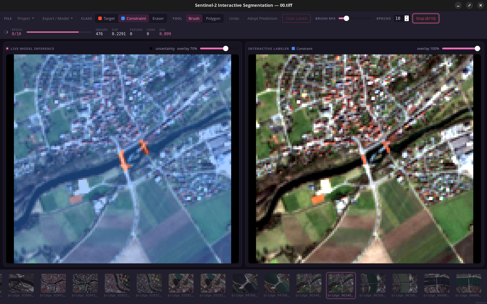

# Kaio-ken Segmenter

A label tool for Remote Sensing, supports GeoTiffs with more than just 3 Bands!



## Disclaimer

This is a prototype for human-in-the-loop (binary) semantic segmentation in
remote sensing with semi-supervised training.
I build this after some exciting talks in a conference. **I also used
AI code generation in this project to get started.**

The tool turned out to be very useful to my work in remote sensing, and I
hope it is useful for others too.
**At the current state I can't guarantee that it works on every machine!**

Workflow: paint ground-truth strokes on the right pane, click
**Train**, and watch the live model inference refresh on the left pane.
Iterate until the prediction is good, then export the model (`.pth`/`.onnx`),
a standalone executable, or the merged mask.

## Install & run

```bash
# CPU-only torch (no CUDA download); drop the extra index on a GPU machine
python3 -m pip install --extra-index-url https://download.pytorch.org/whl/cpu \
    https://github.com/raphi-web/kaioken_segmenter/releases/download/v0.1.0/kaioken_segmenter-0.1.0-py3-none-any.whl
python3 -m kaioken start [path/to/image.tiff | path/to/project_dir]
```

Newer versions: [releases page](https://github.com/raphi-web/kaioken_segmenter/releases).

`pywebview` uses GTK/WebKit2 if available (`PyGObject` + `gir1.2-webkit2-4.1`).
Otherwise install the Qt renderer — quote the brackets:

```bash
python3 -m pip install "kaioken-segmenter[qt] @ https://github.com/raphi-web/kaioken_segmenter/releases/download/v0.1.0/kaioken_segmenter-0.1.0-py3-none-any.whl"
```

Same syntax: `[export]` for "Export Executable", `[qt,export]` for both.

### Commands

```bash
python3 -m kaioken start [PATH]                     # open the labelling app
python3 -m kaioken fetch-assets                     # download optional model assets
python3 -m kaioken predict -m model.onnx IMG.tif    # run an exported model, no GUI
python3 -m kaioken paths                            # show asset lookup paths
```

`kaioken start` also works as a bare command.

`predict` runs a **model you exported** (not pretrained weights). `-m` defaults
to `model.onnx` in the cwd; pass the path anywhere else. Writes prediction next
to the input unless `-o` says otherwise. `--help` lists band mapping, nodata,
and probability-raster options.

### Optional assets

The wheel ships no weights. Both are downloaded on demand into a per-user
cache (`~/.cache/kaioken` on Linux):

```bash
python3 -m kaioken fetch-assets --weights   # 23 MB, pretrained init
python3 -m kaioken fetch-assets --sam2      # 126 MB, click-assist
```

Missing weights → trains from scratch. Missing SAM2 → click-assist stays
disabled. Override with `KAIOKEN_WEIGHTS` / `KAIOKEN_SAM2_DIR`.

### Export Executable

Packages a standalone predictor with PyInstaller — no Python needed on the
target. Builds on demand and takes a few minutes:

```bash
pip install "kaioken-segmenter[export]"
```

Without it the button is disabled. Result: ~300 MB folder with `predictor`
and `model.onnx`. Double-click to open, or `predictor --help` for CLI flags.

## Development

```bash
git clone https://github.com/raphi-web/kaioken_segmenter.git
cd kaioken_segmenter
python3 -m venv venv
venv/bin/pip install --extra-index-url https://download.pytorch.org/whl/cpu -e ".[dev,qt]"
cd frontend && npm install && npm run build && cd ..
venv/bin/python -m kaioken start          # defaults to 00.tiff
venv/bin/python -m pytest
```

From a checkout, asset lookups fall back to the repo's `pretraining/`,
`sam2/onnx/`, `frontend/dist/`. Nothing needs downloading.

## Building the wheel

### Prerequisites

- Python 3.10+ with `build` (`pip install build`, or `-e ".[dev]"`).
- Node.js / npm on the **build** machine only. The React UI is compiled here
  and bundled into the wheel, so end users never need Node.

### Build

```bash
python3 -m build
```

Writes to `dist/`:

| File                                       | Size    |
| ------------------------------------------ | ------- |
| `kaioken_segmenter-0.1.0-py3-none-any.whl` | ~170 KB |
| `kaioken_segmenter-0.1.0.tar.gz`           | ~140 KB |

The wheel is `py3-none-any` — one build works everywhere.

`hatch_build.py` runs `npm ci && npm run build` in `frontend/` and copies the
result into `src/kaioken/_frontend/`. If the copy is empty the build **fails**
rather than shipping a wheel with no UI. To reuse a prebuilt frontend:

```bash
cd frontend && npm run build && cd ..
KAIOKEN_SKIP_FRONTEND_BUILD=1 python3 -m build --wheel
```

### Check what you built

The wheel should carry the UI and **no** model assets (a stray `.pth` or
`.onnx` would mean a ~450 MB wheel):

```bash
unzip -l dist/*.whl | grep _frontend            # expect index.html + assets/
unzip -l dist/*.whl | grep -E '\.pth|\.onnx$'   # expect no matches
```

### Install it

On the target machine, in a fresh venv:

```bash
python3 -m venv .venv
# CPU-only torch (~200 MB); drop the extra index on a GPU machine to get CUDA
.venv/bin/pip install --extra-index-url https://download.pytorch.org/whl/cpu \
    dist/kaioken_segmenter-0.1.0-py3-none-any.whl
.venv/bin/python -m kaioken start
```

Add extras as usual: `[export]` for PyInstaller, `[qt]` if no GTK/WebKit2.

Confirm:

```bash
.venv/bin/python -m kaioken paths
```

Run from **outside** the repo. It should print `source tree : (installed, not
a checkout)` and point at `site-packages/kaioken/_frontend/`. If it names the
repo, you're running the checkout.

### Troubleshooting

| Symptom                                         | Cause                                                                                                                        |
| ----------------------------------------------- | ---------------------------------------------------------------------------------------------------------------------------- |
| `npm not found on PATH`                         | Node missing. Install it, or prebuild `frontend/dist` and set `KAIOKEN_SKIP_FRONTEND_BUILD=1`.                               |
| `frontend build produced no .../index.html`     | Vite build failed — scroll up for its error.                                                                                 |
| `paths` names the repo after installing a wheel | Venv is inside the checkout **and** you're running from `src/`. Check `python -c "import kaioken; print(kaioken.__file__)"`. |
| Torch pulls gigabytes                           | CUDA build is the default. Add `--extra-index-url https://download.pytorch.org/whl/cpu`.                                     |

## How it works

### 1. Data & Classes

- Target (0): Orange. Background (1): Blue.
- Unlabeled (255): ignored during training; treated as nodata.
- Preprocessing: per-band 2nd–98th percentile scaling to [0, 1], ignoring nodata.

### 2. Model Architecture

- Encoder/decoder trained from scratch: residual depthwise-separable CNN
  encoder, decoder with skip connections and channel attention, selectable
  1/16-scale bottleneck (`data_profile.bottleneck`):
  - `conv` (default): plain conv block, 64 base channels, ~3.0M params.
    Better on 10 m/px imagery (0.535 vs 0.428 mean IoU over 3 seeds), half the size.
  - `transformer`: pre-norm transformer block, 44 base channels, ~5.7M params.
    For higher-resolution imagery.
- Input: raw bands, 96×96 patches (default; any multiple of 16).
- Output: one logit per class per pixel; softmax for probabilities.
- Inference: overlapping tiles with logit averaging for smooth full-image results.
- Optional PointRend head for sharper boundaries on uncertain pixels.

### 3. Training Strategy

- Supervised: cross-entropy + Dice on user-labeled pixels.
- Semi-supervised: FixMatch-style pseudo-labeling on confident (>0.9) predictions.
- Consistency: MSE between weak/strong augmentations.
- Gating: unsupervised terms stay off until target IoU 0.55 holds for 3
  consecutive epochs, then fade in over 60% of remaining epochs.

### 4. SAM2 Assist

- Efficient-SAM2 exported to ONNX, runs via onnxruntime — no GPU or heavy
  PyTorch needed for click-to-segment.

### 5. Exports

- **Model/State Dict**: training weights.
- **ONNX/Executable**: standalone predictor (tiling, scaling, thresholding).
- **Mask**: 1-band uint8 GeoTIFF (prediction + user labels) with original CRS/affine.

## Frontend development

```bash
cd frontend && npm run dev   # hot-reload UI (bridge calls need the pywebview host)
npm run build                # rebuild dist/, picked up directly by a checkout run
```
